# Vibely

**A hyperlocal community platform that helps adults over 50 meet neighbours at real, in-person activities.**

AI suggests local activities, members vote and join, and hosts, organisations and local businesses run everything from one place. The app is accessible and works in 8 Indian languages.

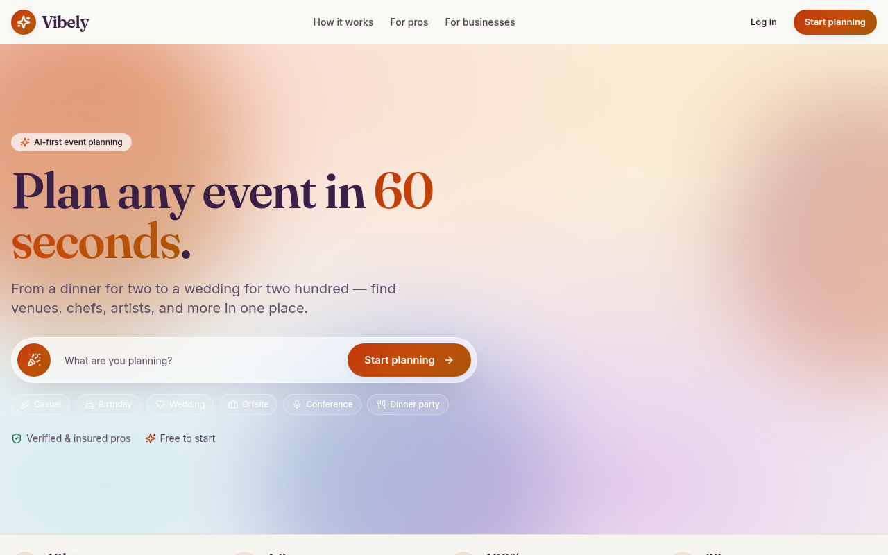

---

## Contents
- [Objectives](#objectives)
- [Key features](#key-features)
- [Screens and interactions](#screens-and-interactions)
- [User roles](#user-roles)
- [Tech architecture](#tech-architecture)
- [Security](#security)
- [Getting started](#getting-started)
- [Further reading](#further-reading)

---

## Objectives

**North star:** adults over 50 regularly gather in person with neighbours at local activities.
**Measured by:** members marked as attending a hosted activity each month.

| Pillar | What it means |
|---|---|
| **Hyperlocal** | Circles and activities are built around members who live within about 1 mile of each other. |
| **AI-assisted** | AI drafts monthly activity proposals, event plans, run-of-show timelines and shareable invites. |
| **Accessible** | Larger text, high contrast, reduced motion, WCAG AA colours and clear keyboard focus. |
| **Multilingual** | English, Hindi, Telugu, Urdu, Kannada, Bengali, Marathi and Tamil. |
| **Sustainable** | Paid tools for hosts, pros and businesses: perks, sponsorships, bookings and billing. |

---

## Key features

- **Plan in 60 seconds:** type what you want to do on the landing page. The idea carries through sign-up and becomes your first activity.
- **Activities (events):** briefs, AI-generated plans and run-of-show, guest details, and shareable AI invites (image and copy for WhatsApp and social media).
- **Circles:** local groups based on where members live.
- **Proposals:** a monthly set of AI-suggested activities based on how many members live nearby. Members vote on them.
- **Marketplace and Perks:** venues, pros and businesses ranked by a **Fit Score** against the activity brief, plus member perks from local businesses.
- **Nearby places:** city autocomplete, "use my location", and top-rated places near you, all powered by OpenStreetMap.
- **Orgs (CRM):** inquiries, conversations, bookings, tasks and AI call outcomes.
- **Calendar:** master calendar, availability and scheduling.
- **Billing:** transactions, invoices, receipts, payouts and profit and loss.
- **Trust:** verification, professional credentials, insurance, reviews and disputes.
- **Memorabilia and Sponsorship:** keep memories of past activities and offer sponsorship packages.
- **Admin suite:** feature flags, AI settings, localisation, moderation, verification queue and commerce.

---

## Screens and interactions

### Plan an activity from the landing page


### Switch language instantly


### Home dashboard (adapts to each role)
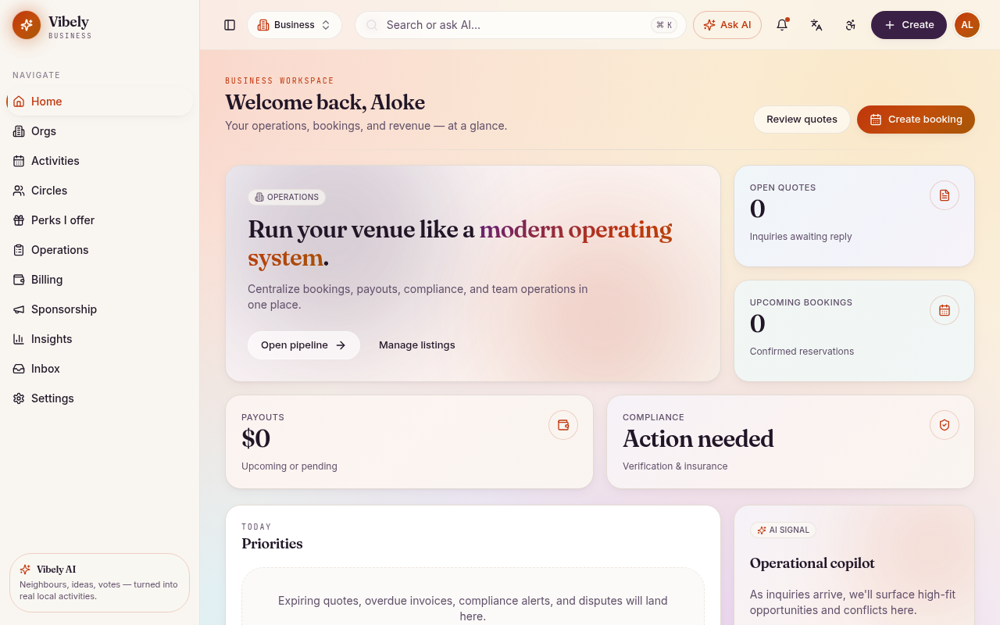

| Activities | Marketplace |
|---|---|
| 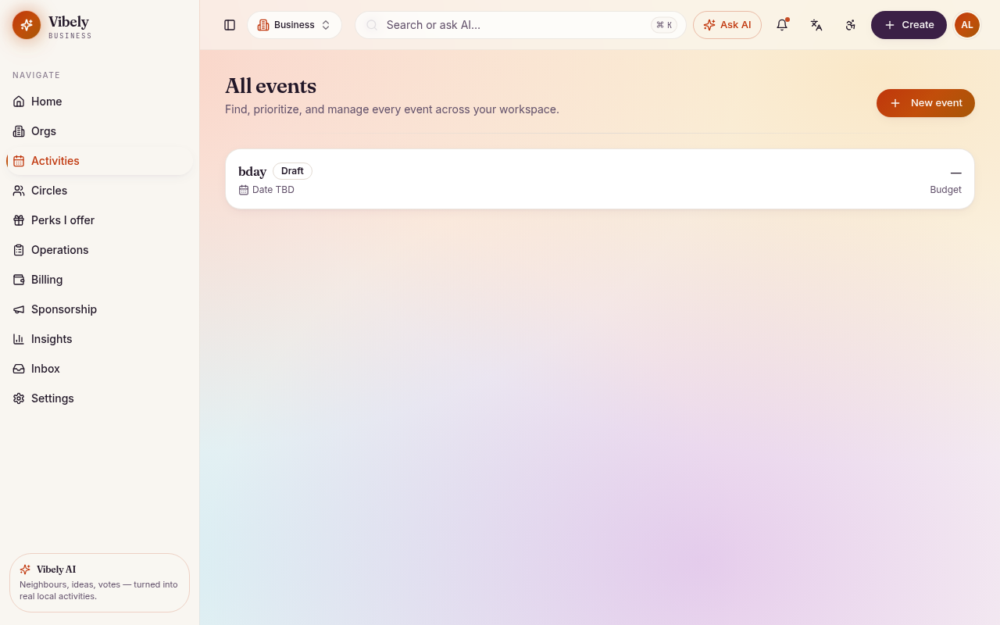 | 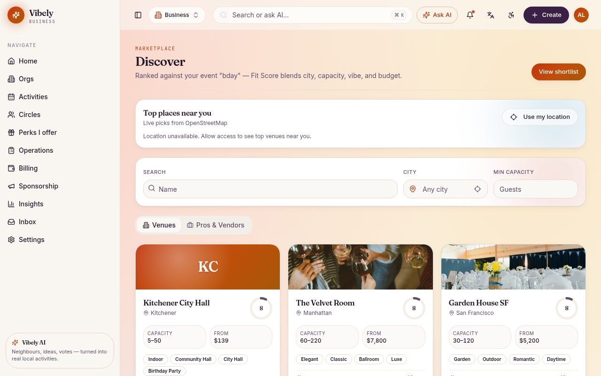 |
| **Circles** | **Proposals** |
| 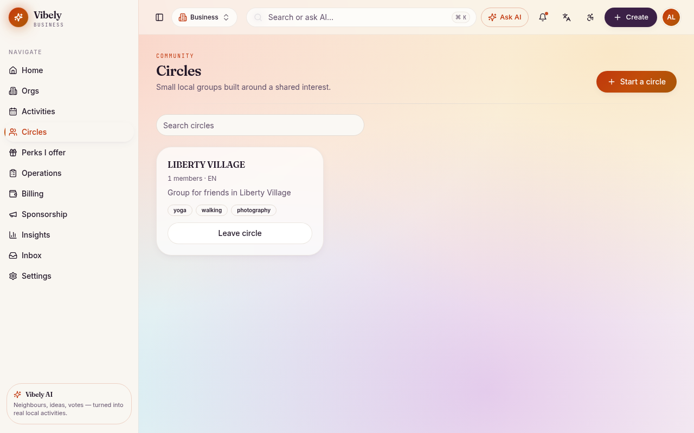 | 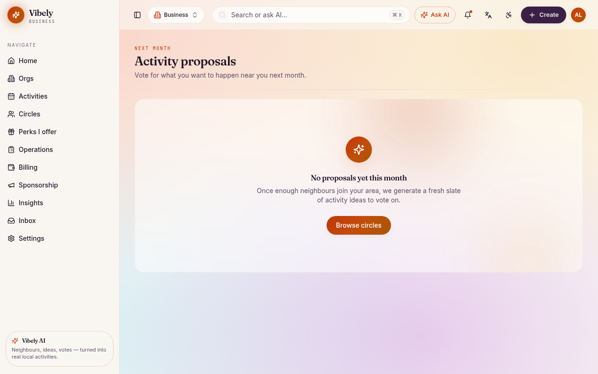 |
| **Perks** | **Calendar** |
| 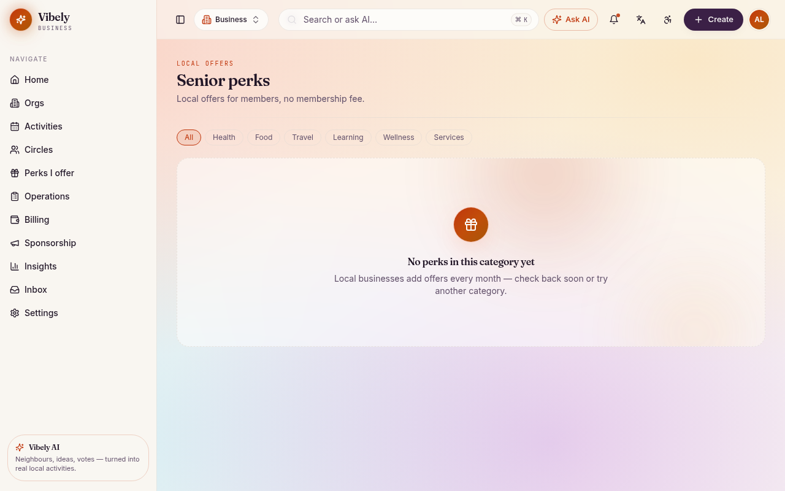 |  |
| **Billing** | **Trust** |
| 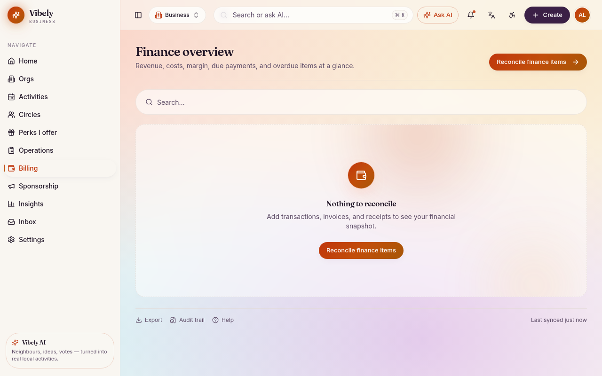 | 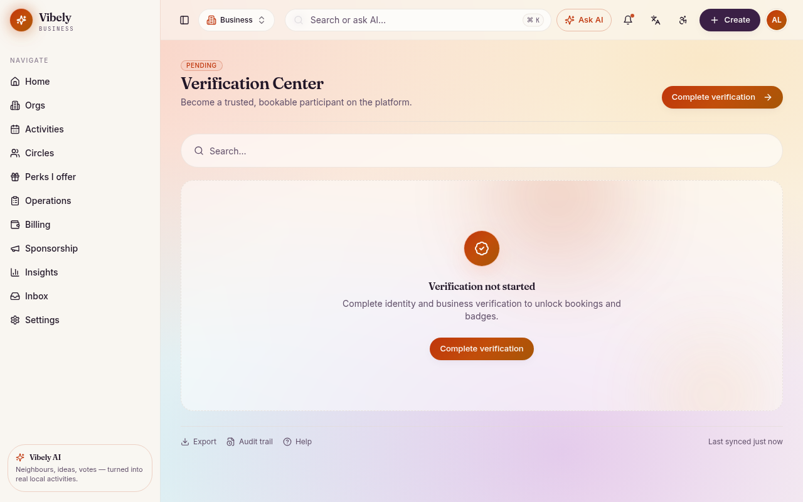 |
| **Sign in** | **Mobile** |
| 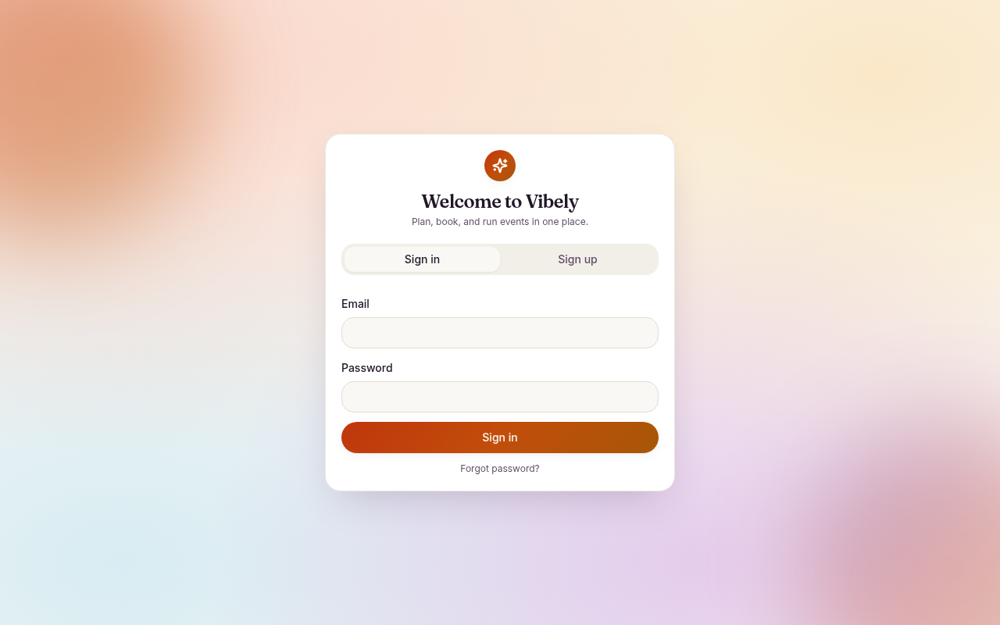 | 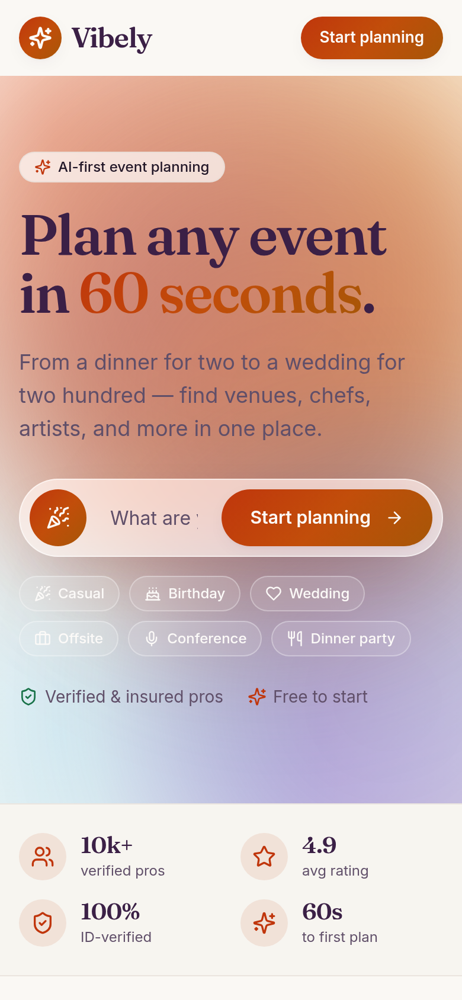 |

---

## User roles

One app for every role. Navigation and dashboards change based on the signed-in user's roles.

| Role | Can do |
|---|---|
| Member | Join circles, vote on proposals, attend activities, redeem perks |
| Host | Create and run activities, plans and invites |
| Circle admin | Manage a local circle and its members |
| Org rep | Run activities on behalf of an organisation |
| Business | Manage venues, perks, bookings, staff and billing |
| Pro | Offer services, manage leads, bookings, credentials and earnings |
| Staff / moderator | Moderation and the verification queue |
| Super admin | Feature flags, AI settings, localisation and commerce |

Roles are stored in a separate `user_roles` table and checked by secure database functions. Users can only give themselves roles that carry no special privileges.

---

## Tech architecture

```text
 ┌───────────────────────────── Browser (SPA) ─────────────────────────────┐
 │ React 18 · TypeScript · Vite · Tailwind · shadcn/ui · Lucide            │
 │ Pages ──► Components ──► Service layer (src/services/*)                 │
 │ TanStack Query (server state) · Zustand (UI state) · RHF + Zod (forms)  │
 │ i18n (8 languages) · Preferences (text size, contrast, motion)          │
 └───────────────┬───────────────────────────────┬─────────────────────────┘
                 │                               │
                 ▼                               ▼
 ┌────────────── Backend (Supabase) ─────────┐   ┌── OpenStreetMap ───────┐
 │ Postgres + Row-Level Security             │   │ Nominatim (geocoding)  │
 │ Auth: email + Google                      │   │ Overpass (nearby POIs) │
 │ Storage: private "invites" bucket         │   └────────────────────────┘
 │ Edge Functions (Deno):                    │
 │   generate-plan · generate-invite         │──► AI provider abstraction
 │   generate-proposals · moderate-content   │    (_shared/ai.ts)
 │   ai-call                                 │    Gemini / OpenAI / Sarvam AI
 └───────────────────────────────────────────┘
```

### Stack
| Layer | Technology |
|---|---|
| UI | React 18, TypeScript (strict), Vite 5, Tailwind CSS 3, shadcn/ui, Lucide icons |
| State and data | TanStack Query, Zustand, React Hook Form + Zod, date-fns |
| Backend | Supabase: Postgres, Auth, Storage and Edge Functions |
| AI | Pluggable provider layer: Gemini for plans, invites and images, OpenAI by default, Sarvam AI for Indian languages |
| Maps and places | OpenStreetMap Nominatim and Overpass (no API key needed) |
| SEO | react-helmet-async, JSON-LD, generated sitemap |
| Testing | Vitest |

### Project structure
```text
src/
  components/    reusable UI (shell, landing, marketplace, ui primitives)
  pages/         landing, auth, invite page, app/* domain screens
  services/      all API and database access (places, plans, invites, finance, community…)
  contexts/      auth and preferences providers
  lib/           i18n, pending brief, helpers
  types/         shared types and schemas
supabase/
  functions/     edge functions + _shared AI layer
  migrations/    database schema and security policies
scripts/         sitemap generator
docs/            README screenshots and GIFs
```

### Design decisions
- **Service layer only:** components never call the database or `fetch` directly.
- **One app for every role:** shared layouts and dashboards that adapt to the user's role.
- **Each AI skill runs as its own edge function,** so providers can be swapped without touching the UI.
- **Money is stored in cents** as integers.

---

## Security
- Row-Level Security is on for every public table. Policies limit access to owners, members or staff.
- Role checks use `SECURITY DEFINER` functions, and `anon` cannot execute them.
- Invite images are kept in a private bucket and shared through signed links.
- Public profile and invite data is only available through limited RPCs.
- Payments and payouts run on the server only (Stripe and Stripe Connect).

---

## Getting started

```bash
# 1. Install
bun install        # or npm install

# 2. Configure environment (.env)
VITE_SUPABASE_URL=...
VITE_SUPABASE_PUBLISHABLE_KEY=...
VITE_SUPABASE_PROJECT_ID=...

# 3. Run (also generates public/sitemap.xml)
bun run dev        # http://localhost:8080

# 4. Test and build
bunx vitest run
bun run build
```

Edge functions are in `supabase/functions/`. Deploy them with `supabase functions deploy <name>` and set the AI provider keys as function secrets.

---

## Further reading
- [PRD.md](PRD.md): full product requirements, roles and admin panels
- [MIGRATION-REPORT.md](MIGRATION-REPORT.md): database migration report
